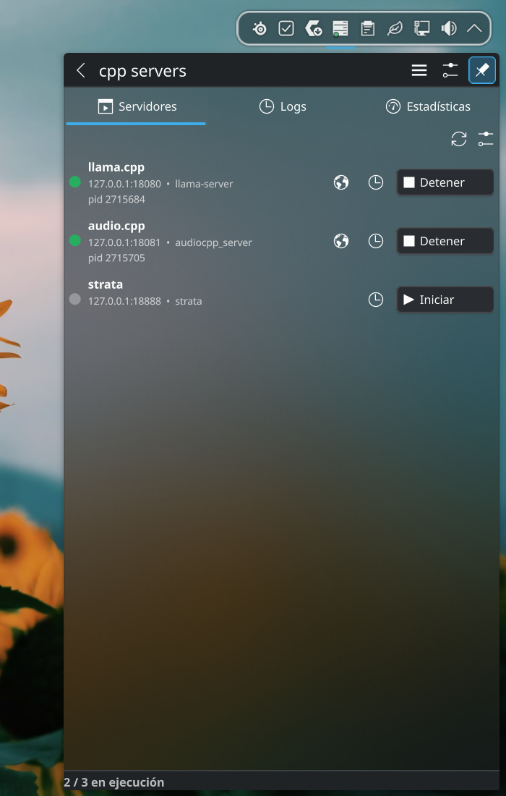
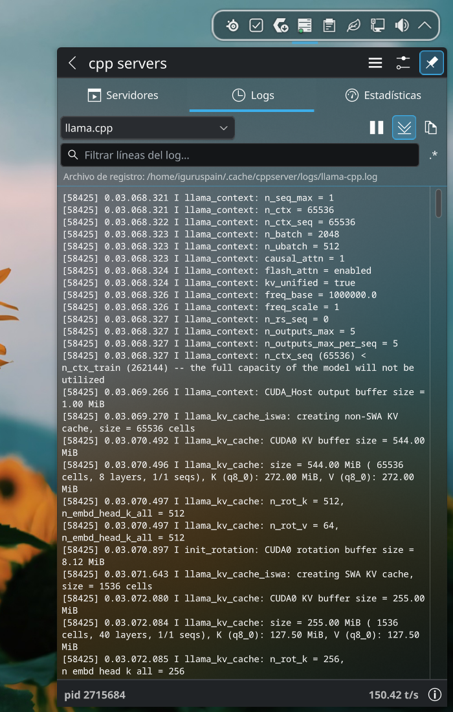

# cpp servers — KDE Plasma Plasmoid

A **KDE Plasma 6** widget to configure, start/stop, and watch live logs and real-time stats of local C++ inference servers (llama.cpp, strata, audio.cpp, stable-diffusion.cpp, …).

## Screenshots

<p align="center">
  
  
</p>

## Install

```bash
bash install.sh                # no sudo; restarts plasmashell
bash install.sh --no-restart   # skip the restart
```

Add the widget: right-click desktop → **Add Widgets** → *cpp servers*.
Uninstall: `bash uninstall.sh` (running servers and logs are not touched).

### System tray

The widget can live in the system tray: right-click the tray → **Configure System Tray…** → **Entries** → *cpp servers* → *Always shown* (or *Shown when relevant*, the default: it is highlighted while at least one server is running). You can also keep it on the desktop or in a panel.

### Install from the GUI (no terminal)

`bash make-plasmoid.sh` creates `org.kde.cppserver.plasmoid`. Then: right-click the desktop → **Add Widgets…** → **Get New Widgets…** → **Install Widget From Local File…** and pick it. To update, remove the old version first (right-click the widget → *Remove*, or `bash uninstall.sh`) and restart plasmashell (`systemctl --user restart plasma-plasmashell`) so the QML cache is refreshed.

Both scripts reinstall from scratch (remove + install, never `--upgrade`) and delete Plasma's QML cache (`~/.cache/plasmashell/qmlcache`), so an old copy can't linger. `install.sh` also builds the translations.

Development without reinstalling: `plasmoidviewer -a ./org.kde.cppserver`.

## Widget

- **Servers** — one row per enabled server: status dot, endpoint, binary, pid, *open in browser* (when a port is set), *logs*, and Start/Stop.
- **Start all / Stop all** — header buttons (system tray) or right-click menu entries (anywhere else). *Start all* starts every shown server that is stopped and whose binary was found; *Stop all* stops every running one. Each button only appears when it has something to do.
- **Logs** — live tail (last 400 lines, every 500 ms) with a server selector, a **filter box** (case-insensitive substring; the `.*` button switches to regular expression; the footer shows matched/total lines), pause, follow-the-end and copy. Text is selectable.
- **Stats** — live monitor dashboard (HTTP probes every second, only while the tab is open): machine rings **first** (CPU, each GPU's load, **VRAM segmented per server process** and RAM — untitled headline block; readouts like `21.7 / 25.6 GiB` never elide); then KPI tiles with **sparklines** (t/s, GPU temp, GPU power, disk, …) that appear only while their source reports data; then one card per running server with state (idle / prefill+generation progress + queue), t/s, a **context ring** on the right (used / max, split into prompt / generated / other) and a fixed **token grid** (requests, tokens in/out, reused, context) whose numbers never reflow the layout, and below it the server's **own recent-requests table** (time, state, prompt tokens, reused, tokens out, decode t/s, duration) — collapsed by default, with its totals footer always visible as a one-line summary; clicking the footer opens or hides the table (there is no merged cross-server table anymore: the card *is* the server); **audio.cpp cards instead replace the token grid with their own info grid** (requests, chunks, wall time, first-audio time over the recent window) **and their own table** (time, model family, error/generating/done, chunks, wall time, first-audio time), since TTS/ASR have no tokens or context — every table's columns are measured from the strings actually painted and stretch proportionally to fill the card at any width (`ReqTable.qml`). Sources: strata's `/metrics` JSON (counters, per-request list, history series); llama-server's Prometheus `/metrics` (add `--metrics`) merged with its log (`n_ctx`, context use, per-request lines — works even without `--metrics`); `nvidia-smi` for per-process VRAM; anything else is checked via `/health` and shows a hint when it exposes no metrics. The **Stats** settings page toggles which sections show.

## Configuration

Right-click the widget → **Configure**. Three pages: **Servers**, **Logs** and **Stats**.

The Servers page is a list of cards (toggle, drag to reorder, edit, remove). **Add** offers templates (llama.cpp, strata launch, audio.cpp, stable-diffusion.cpp, custom — the strata template is `strata launch --preset {PRESET} --no-tui`, default port 18888). Changes are **saved automatically** — there is nothing to Apply.

Everything is stored in `~/.config/cppserver/servers.json` (or `$XDG_CONFIG_HOME/cppserver/`), shared by all instances of the widget and easy to back up or edit by hand; the widget notices external edits within a few seconds.

| Field | Meaning |
|-------|---------|
| Enabled (switch) | Show the server in the widget. A disabled server that is still running stays visible so it can be stopped. |
| Name | Display name. |
| Command | Full command line with placeholders. |
| Host / Port | Values for `{HOST}` / `{PORT}`; port `0` = not used. |
| Config file | Value for `{CONFIG_FILE}` (free path or **Browse…**). |
| Preset | Value for `{PRESET}` (strata launch profile; the editable combobox lists the names from `strata launch --list-presets`, spaces allowed). On `strata launch` cards the Host/Port and Config file rows are hidden — the preset decides what strata binds, and the widget monitors it on the default port 18888. |

Placeholders: `{HOST}`, `{PORT}`, `{CONFIG_FILE}`, `{PRESET}`. `~` and `$HOME` are expanded. If a value is empty the flag in front of it is dropped too (`--port {PORT}` with port 0 disappears). The editor shows the final command under **Will run**.

`servers.json` format:

```json
[
  { "id": "llama-cpp", "name": "llama.cpp", "command": "llama-server --host {HOST} --port {PORT}",
    "host": "127.0.0.1", "port": 8080, "configFile": "", "preset": "", "enabled": true }
]
```

`id` is stable (used for the log/pid file names), so renaming a server never orphans a running process.

The **Stats** page toggles what the Stats tab shows (the live request stream, generation speed, token totals incl. context, VRAM split per server, machine hardware); changes apply immediately. The **Logs** page controls the log view (font size auto/fixed, and which log stat highlights are shown).

## Behavior

- Servers start in their own session (`setsid`), so they survive a plasmashell restart; Stop sends SIGTERM to the whole process group and SIGKILL after 5 s.
- **strata launch** (`strata launch --preset <name>`) detaches its own engine and the launcher exits right away. The widget keeps a `$XDG_CACHE_HOME/cppserver/logs/<id>.strata` marker with the raw preset name, adopts the engine pid strata records in `$XDG_STATE_HOME/strata/runtime/launch-<slug>-*.ready.json` (slug = name lowercased, non-alphanumerics → `-`; so the row stays *running* and Stop asks strata itself with `strata launch --stop --preset <name>` before falling back to SIGTERM), tails strata's own engine log (`$XDG_STATE_HOME/strata/launch/<slug>.engine.log`) in the Logs tab, and refuses to double-start while that engine is alive. A strata engine you started **outside** the widget (a terminal, another session) is never lost: it shows up as a read-only card **strata (external &lt;slug&gt;)** with its logs, stats and a Stop button — no config entry, and the widget never writes its pidfile.
- Logs: `$XDG_CACHE_HOME/cppserver/logs/<id>.log` (usually `~/.cache/cppserver/logs/`); each start truncates the file.
- Running state is derived from `<id>.pid` files (pid + process start time, so recycled PIDs are not mistaken for a server). Servers started elsewhere with the same id are adopted automatically.
- Missing binary: the row turns red and Start is disabled until it is in `PATH` (`~/.local/bin` is included).
- Removing a server in the settings does **not** kill a running process.
- The Stats tab polls every running server once per second (HTTP via `cppserverctl.sh probe <url>`, a curl call with a short timeout) — and only while that tab is open; like everything else it goes through the widget's serialized, watchdog-protected command queue.

## Translations (i18n)

All user-visible text is written in English inside `i18n()` / `i18np()` calls; translations live in `po/<lang>.po` (domain `plasma_applet_org.kde.cppserver`). Spanish (`es`) is included.

| Task | Command |
|------|---------|
| Extract strings → `po/template.pot` and merge into every `.po` (run after changing any text) | `bash translate/merge.sh` |
| Start a new language, e.g. French or Brazilian Portuguese | `bash translate/new-language.sh fr` / `pt_BR` |
| Compile `.po` → `contents/locale/<lang>/LC_MESSAGES/*.mo` and write `Name[<lang>]`/`Description[<lang>]` into `metadata.json` | `bash translate/build.sh` (also run by `install.sh`) |

Workflow for a new language: `new-language.sh <lang>` → translate `po/<lang>.po` (any editor, or Lokalize/Poedit) → `bash install.sh`. Needs `gettext` (`xgettext`, `msgmerge`, `msginit`, `msgfmt`) and `python3`. Test a language with e.g. `LANGUAGE=es plasmoidviewer -a .`.

Rules for contributors: never concatenate translated fragments; use placeholders (`i18n("Failed to start %1", name)`) and `i18np` for plurals.
